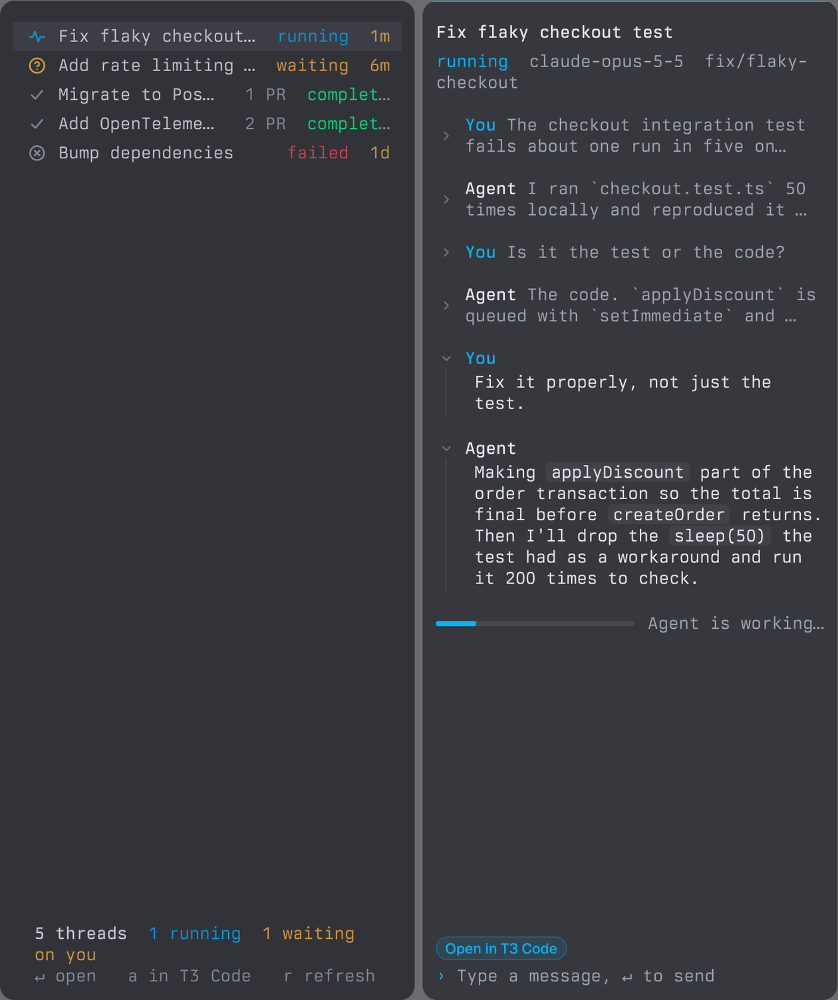
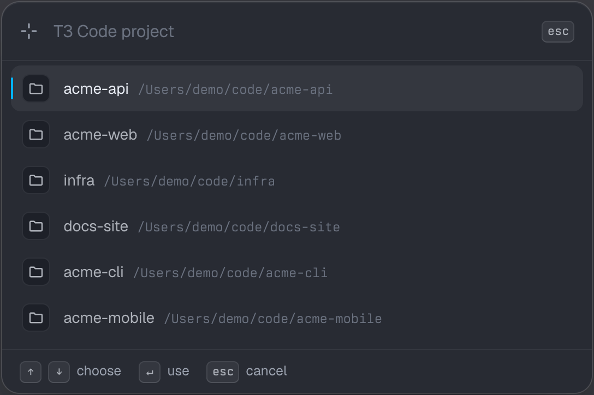

<div align="center">

# T3 Code for Tern

**Your [T3 Code](https://github.com/pingdotgg/t3code) agent threads, inside the [Tern](https://docs.stencil.so/tern/) terminal.**

Start a thread from any pane, hand an agent your failing command, and read and reply to threads
in native Tern blocks, without leaving the terminal.



</div>

## Features

- **Thread list.** Every thread in the project with its status, PR count and age, live while agents work.
- **Thread view.** Title, status, model, branch and PRs, the latest 30 messages (older ones folded to a line) and a message box to reply.
- **Start from the terminal.** Open a new thread in the focused pane's project, or send it your terminal output with an instruction such as "Why did this fail? Fix it."
- **Links.** `t3-thread://` links open in Tern; ⌘-click opens them in the T3 Code app.
- **Status line.** `T3 2 running · 1 waiting` for the project you're in. Click it for the thread list.
- **Works anywhere.** Outside a project folder, it asks which project you mean.

<p align="center">
  
</p>

## Install

You need [Tern](https://docs.stencil.so/tern/) and the [T3 Code](https://github.com/pingdotgg/t3code)
desktop app on the same machine. The app installs the `t3` CLI this plugin drives.

```sh
tern plugin install github.com/rcnsh/tern-t3
tern plugin list        # t3 0.1.0 T3 Code — 2 blocks, 0 lenses, window  ready
```

To hack on it, clone it and link the clone instead:

```sh
git clone https://github.com/rcnsh/tern-t3 ~/dev/tern-t3
tern plugin link ~/dev/tern-t3
```

## Usage

Open Tern's command palette and type `T3`:

| Command | What it does |
| --- | --- |
| **New T3 thread** | Asks for a message, starts a thread and opens it beside the pane. |
| **Send terminal output to a new T3 thread** | Asks what you want done, then starts a thread with that, the last command, its exit status and the pane's last 120 lines. |
| **Show T3 threads** | Opens the project's thread list. |
| **Open project in T3 Code** | Opens the project in the desktop app. |

### Keys

| Thread list | |
| --- | --- |
| <kbd>↑</kbd> <kbd>↓</kbd> or <kbd>k</kbd> <kbd>j</kbd> | Move |
| <kbd>↵</kbd> | Open the thread in Tern |
| <kbd>a</kbd> | Open the thread in the T3 Code app |
| <kbd>r</kbd> | Refresh |

| Thread view | |
| --- | --- |
| Type, then <kbd>↵</kbd> | Send a message |
| <kbd>⌥</kbd> <kbd>↵</kbd> | New line |
| <kbd>Esc</kbd> | Clear the message |

## How it works

T3 Code has no plugin system, so this is a Tern plugin that drives T3 Code's `t3` CLI.

| File | Runs in | Holds |
| --- | --- | --- |
| [`host.luau`](host.luau) | Tern's session daemon | The thread list and thread blocks. They refresh every 3 s while an agent works, 15 s otherwise. |
| [`window.luau`](window.luau) | Each Tern window | Palette commands, the `t3-thread://` link route and the status line. |
| [`common.luau`](common.luau) | Both | Running `t3`, thread statuses, links and the project list. |

- Threads come from `t3 thread list|show|start|send`; the app opens with `t3 app` or a `t3code://threads/<environment>/<thread>` link.
- The CLI can't list projects, so the picker reads them read-only from T3 Code's state database
  (`~/.t3/userdata/statev2.sqlite`) with `/usr/bin/sqlite3`. A T3 Code update that changes that schema would break the picker.
- The status line runs `t3` only for folders inside a project.

## Limits

- **Polling, not streaming.** Tern plugins can only run a process to completion and can't open a WebSocket, so views refresh on a timer.
- **Agent questions.** When an agent asks you something (`waiting`), answer it in the T3 Code app.
- **Desktop only.** Tern's iOS client can't run processes, and its web tab runs no plugin code.

## Development

```sh
tern plugin types .     # writes tern.d.luau (gitignored)
luau-lsp analyze --platform=standard --definitions=@tern=tern.d.luau common.luau host.luau window.luau
tern plugin reload      # pick up edits
```

`luau-lsp` comes from its [GitHub releases](https://github.com/JohnnyMorganz/luau-lsp/releases).
To test in a separate window, start one with `tern --control /tmp/t3.sock ~/some/project` and drive it with
`tern ctl --control /tmp/t3.sock plugins run plugin.t3.threads`.
