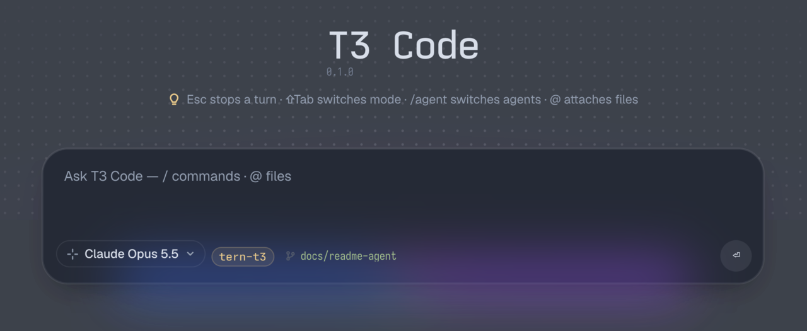
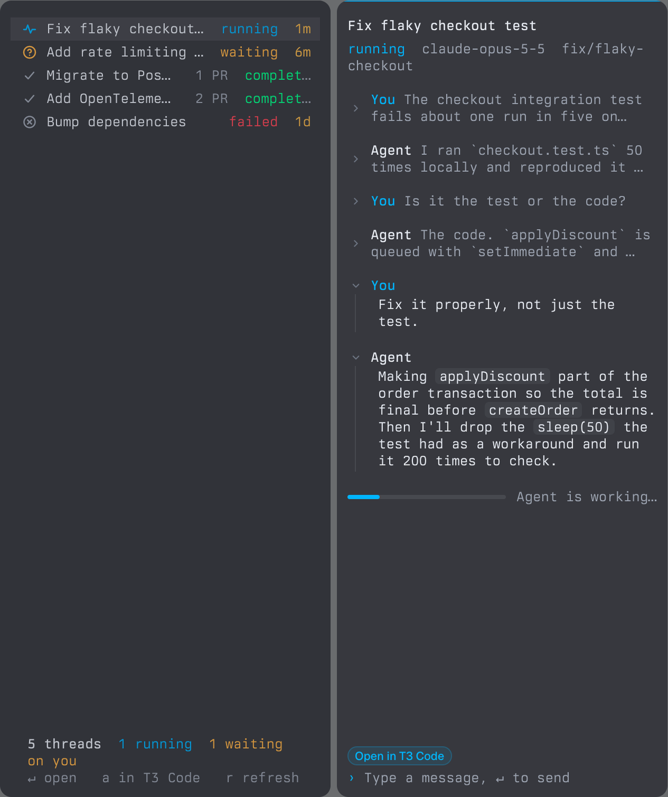
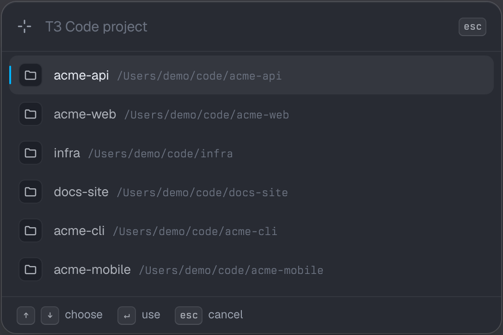

<div align="center">

# T3 Code for Tern

**Your [T3 Code](https://t3.codes) agents, inside the [Tern](https://stencil.so/tern) terminal.**

Pick T3 Code as Tern's agent and chat with it in Tern's own agent pane, or work with T3 threads in native Tern blocks:
start one from any pane, hand it your failing command, and read and reply without leaving the terminal.



</div>

## Two ways in

- **T3 Code as Tern's agent.** Choose T3 Code in Tern's agent settings and ⇧⌘A opens a chat with it in Tern's agent pane.
  Each chat is a T3 thread, with T3's models and projects in the pickers under the message box.
- **T3 threads in Tern blocks.** Palette commands start threads, list a project's threads and open one in a block, with a
  status line count and a toast when an agent stops.

Both drive the same T3 Code threads, so anything you start in Tern is in the T3 Code app too, and the other way round.

## Install

You need [Tern](https://stencil.so/tern) and the [T3 Code](https://t3.codes) desktop app on the same machine. The app
installs the `t3` CLI this plugin drives.

```sh
tern plugin install github.com/rcnsh/tern-t3
tern plugin list        # t3 0.1.0 T3 Code — 2 blocks, 0 lenses, window  ready
```

To hack on it, clone it and link the clone instead:

```sh
git clone https://github.com/rcnsh/tern-t3 ~/dev/tern-t3
tern plugin link ~/dev/tern-t3
```

### Add T3 Code to Tern's agents

The agent is a separate program, [`acp/t3-acp.mjs`](acp/t3-acp.mjs), that Tern runs with Node 22 or newer. Add it to
Tern's `settings.json` under `agents.custom`:

```json
"agents": {
  "custom": [
    {
      "id": "t3",
      "name": "T3 Code",
      "command": "node",
      "args": ["/path/to/tern-t3/acp/t3-acp.mjs"]
    }
  ]
}
```

The path is your clone, or for an installed plugin the `t3` folder in `tern plugin dir`. If Tern can't find `node`, give
its full path (`which node`).

Then pick **T3 Code** in **Settings › Agents › Agent**. ⇧⌘A opens it from then on, and `tern acp t3` opens it from any
shell without changing the setting.

## T3 Code as Tern's agent

- **One chat, one thread.** Your first message starts a T3 thread; the rest of the chat goes to that thread.
- **Model picker.** The model chip lists T3 Code's models by provider, with T3's default ticked. Your custom models and
  favourites are there too.
- **Project picker.** The chip beside it lists your T3 Code projects. It starts on the project holding the chat's folder,
  or the one you used last when the folder isn't in one. ⇧Tab cycles it.
- **Set at the start.** The project and model are fixed once the first message starts the thread, because the `t3` CLI
  can't change them afterwards. To use different ones, start a new chat with `/new`.
- **Earlier threads.** `/sessions` lists the project's T3 threads. Opening one loads its messages, and new messages
  continue it.
- **Questions.** When the agent asks you something, the chat says so and links to the thread in the T3 Code app, where
  you answer it.

## T3 threads in Tern blocks



- **Thread list.** Every thread in the project with its status, PR count and age, live while agents work.
- **Thread view.** Title, status, model, branch and PRs, the latest 30 messages (older ones folded to a line) and a
  message box to reply.
- **Start from the terminal.** Open a new thread in the focused pane's project, optionally in its own git worktree, or
  send it your terminal output with an instruction such as "Why did this fail? Fix it."
- **Links.** `t3-thread://` links open in Tern; ⌘-click opens them in the T3 Code app.
- **Status line.** `T3 2 running · 1 waiting` for the project you're in. Click it for the thread list.
- **Notifications.** A toast when an agent finishes, fails or starts waiting on you, in any project where one was running.
- **Works anywhere.** Outside a project folder, commands ask which project you mean.

<p align="center">
  
</p>

Open Tern's command palette and type `T3`:

| Command | What it does |
| --- | --- |
| **New T3 thread** | Asks for a message, starts a thread and opens it beside the pane. |
| **New T3 thread in a worktree** | Asks which branch, tag or commit to base it on (the current branch to start with), then for a message, and starts the thread in a new git worktree. |
| **Send terminal output to a new T3 thread** | Asks what you want done, then starts a thread with that, the last command, its exit status and the pane's last 120 lines. |
| **Show T3 threads** | Opens the project's thread list. |
| **Open project in T3 Code** | Opens the project in the desktop app. |

| Thread list | |
| --- | --- |
| <kbd>↑</kbd> <kbd>↓</kbd> or <kbd>k</kbd> <kbd>j</kbd> | Move |
| <kbd>↵</kbd> | Open the thread in Tern |
| <kbd>a</kbd> | Open the thread in the T3 Code app |
| <kbd>r</kbd> | Refresh |

| Thread view | |
| --- | --- |
| Type, then <kbd>↵</kbd> | Send a message |
| <kbd>⌥</kbd> <kbd>↵</kbd> | New line |
| <kbd>Esc</kbd> | Clear the message |

## How it works

T3 Code has no plugin system, so everything here drives T3 Code's `t3` CLI.

| File | Runs in | Holds |
| --- | --- | --- |
| [`acp/t3-acp.mjs`](acp/t3-acp.mjs) | Node, started by Tern's agent pane | The agent. It speaks [ACP](https://agentclientprotocol.com) to Tern and maps each chat to a T3 thread with `t3 thread start\|send\|show\|list`. |
| [`acp/catalog.mjs`](acp/catalog.mjs) | Node | The agent's project and model lists. |
| [`host.luau`](host.luau) | Tern's session daemon | The thread list and thread blocks. They refresh every 3 s while an agent works, 15 s otherwise. |
| [`window.luau`](window.luau) | Each Tern window | Palette commands, the `t3-thread://` link route, the status line and notifications. |
| [`common.luau`](common.luau) | Both Luau halves | Running `t3`, thread statuses, links and the project list. |

- Threads come from `t3 thread list|show|start|send`; the app opens with `t3 app` or a
  `t3code://threads/<environment>/<thread>` link.
- The agent polls `t3 thread show` once a second during a turn and passes each new message to Tern's chat.
- The CLI lists neither projects nor models, so both are read, read-only, from T3 Code's files under `~/.t3/userdata`.
  Projects come from its state database (`statev2.sqlite`, through `/usr/bin/sqlite3`). Models come from
  `model-manifest.json` (each provider's current models) and `settings.json` (enabled providers, custom models and
  favourites). A T3 Code update that changes these files would empty the lists, but chats would still start on T3's
  defaults.
- A chat has no thread until its first message, so the agent keeps which thread each new chat became in
  `~/.local/state/tern-t3/acp-sessions.json`.
- The status line runs `t3` only for folders inside a project.
- Notifications track running threads in the plugin's `kv.json`, shared by every window, and check their projects every
  15 s whichever pane has focus. A thread that starts and stops between checks is announced only when it was started
  from Tern.

## Limits

- **Whole messages, not streaming.** `t3 thread show` reports finished messages only, so a reply appears a message at a
  time, with no tool calls or thinking. The blocks poll for the same reason: Tern plugins can only run a process to
  completion and can't open a WebSocket.
- **Esc doesn't stop the run.** In the agent chat, Esc stops following the turn, but the `t3` CLI can't interrupt a run,
  so it carries on in T3 Code.
- **Running threads.** Opening a thread that is still running shows the messages finished so far; the rest of that run
  shows only in T3 Code.
- **Questions go to the app.** When an agent waits on you, answer it in the T3 Code app.
- **Desktop only.** Tern's iOS client can't run processes, and its web tab runs no plugin code.

## Development

```sh
tern plugin types .     # writes tern.d.luau (gitignored)
luau-lsp analyze --platform=standard --definitions=@tern=tern.d.luau common.luau host.luau window.luau
node --check acp/t3-acp.mjs && node --check acp/catalog.mjs
node acp/smoke.mjs acp/t3-acp.mjs ~/some/project    # drives the agent over stdio; starts a real T3 thread
tern plugin reload      # pick up edits
```

`luau-lsp` comes from its [GitHub releases](https://github.com/JohnnyMorganz/luau-lsp/releases). The agent has no
dependencies. A chat pane keeps its copy running (`/new` reuses it), so close the pane and open a new chat to pick up
edits.

To test in a separate window, start one with `tern --control /tmp/t3.sock ~/some/project` and drive it with
`tern ctl --control /tmp/t3.sock …`; [AGENTS.md](AGENTS.md) has the details.

## License

[MIT](LICENSE)
